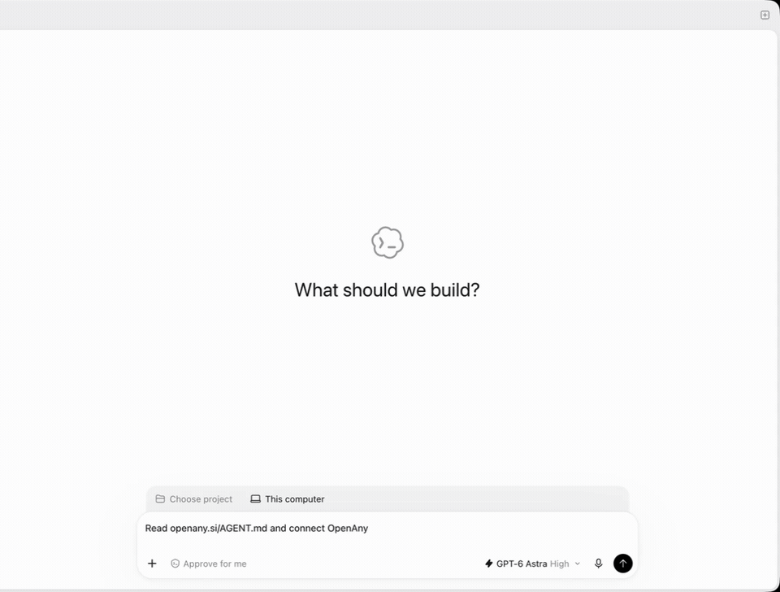
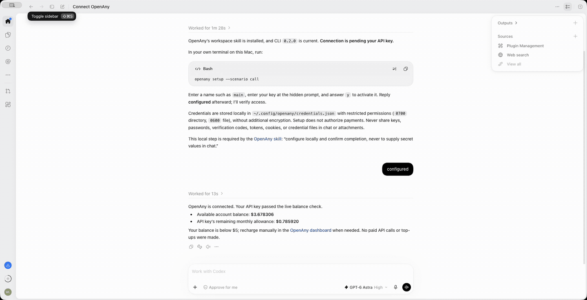

# OpenAny

One API key for AI agents to discover and call AI models, data APIs, and tools through OpenAny.

[Website](https://openany.si/) · [Agent instructions](https://openany.si/AGENT.md) · [Skill](https://openany.si/SKILL.md)

## Connect your agent

Paste this instruction into your agent:

```text
Read openany.si/AGENT.md and connect OpenAny
```

Your agent needs terminal and network access, Node.js 22 or later, and the OpenAny CLI. Follow the [agent instructions](https://openany.si/AGENT.md) to install the CLI and configure access. If you do not have an API key yet, see the [authentication guide](https://openany.si/AUTH.md).

## Supported agents

- [Claude Code](guides/claude-code.md)
- [Cursor](guides/cursor.md)
- [Codex](guides/codex.md)
- [Hermes Agent](guides/hermes.md)
- [OpenClaw](guides/openclaw.md)

These agents connect through the OpenAny skill and CLI. See the [client setup recipes](https://openany.si/docs/agents.json) for each agent's skill installation location and setup steps.

API calls use your OpenAny API key and shared balance. Configure credentials locally; never paste API keys or wallet private keys into agent chats.

## Examples

- [Search Facebook Ad Library](examples/facebook-ad-library/README.md): copy a prompt into your agent to find active ads matching a keyword and see advertiser names, ad links, and the recorded cost.

## Demo

### Connect an agent



### Search Facebook Ad Library

Discover and call an API through OpenAny, then view the results, recorded cost, and request ID.



## Contributing

Corrections and improvements are welcome. See [CONTRIBUTING.md](CONTRIBUTING.md) for contribution guidelines.

## License

The contents of this repository are available under the [MIT License](LICENSE). The separately distributed OpenAny CLI, hosted services, and third-party APIs remain subject to their own licenses and terms.
